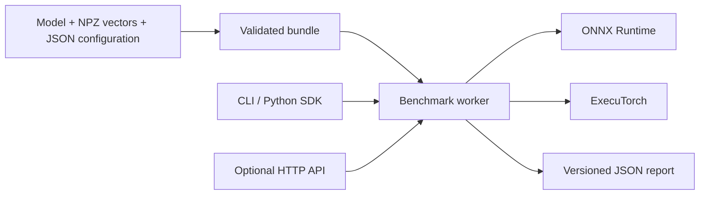

# Architecture

EdgeForge turns a trusted local ONNX model or exported ExecuTorch program and
numeric test vectors into a portable bundle. It measures that bundle where it
runs. It does not implement an inference engine or claim that a host benchmark
predicts another device's performance.

## Boundaries

`contracts` defines versioned JSON models. `bundle` validates and hashes assets
without extracting archives. Runtime adapters load model bytes and expose one
synchronous inference interface. The benchmark layer owns warmup, measurement,
output comparison, and capability reporting. CLI and optional HTTP transports
call the same SDK functions.

## Portability and repeatability

An `.efb` file contains exactly `manifest.json`, `model.bin`, and `vectors.npz`.
ZIP entries use fixed metadata and no compression. The manifest records asset
sizes and SHA-256 digests, input/output order, dtypes, shapes, preprocessing,
thread settings, runtime selection, and quantization provenance. Identical
inputs produce identical bundle bytes within the supported format version.
Benchmark timing is inherently variable and is never part of the bundle hash.
Runtime and dependency versions belong in reports and environment lock files.

Each NPZ array has a case axis, then the exact tensor shape. Names are
`input__<name>` or `output__<name>`. Pickled arrays, nonfinite values, unknown
entries, inconsistent cases, and excess resource sizes are rejected.
Preprocessing is `(input * scale) + offset`, in the declared floating dtype.
Golden outputs represent the post-preprocessing model result.

## SaaS interoperability and scaling

The Python SDK and JSON Schema are the stable integration boundary. Artifact
digests provide cache and object-store keys; reports reference the exact bundle.
The optional API accepts registered bundle IDs, never arbitrary filesystem paths,
URLs, Python modules, or model uploads. It is a bounded single-worker service
for trusted integration, with a documented path to queued isolated workers.
Independent worker processes scale across devices; benchmark concurrency on
one device would invalidate timing and is intentionally restricted.

Storage, identity, billing, distributed scheduling, tenant isolation, cloud
deployment, and model registries stay outside the MVP. An eventual control plane
can pass immutable bundles through object storage and retain reports by digest.

## Performance and security

Load once, warm up separately, measure inference only, and report the scope of
every metric. RSS includes the whole process; it is not accelerator memory.
Provider availability does not prove that every node executes on that provider.
Native runtime parsing is not a security sandbox. Use trusted models and isolate
workers before processing third-party models. See [security](../security.md).

## Retained benchmark report review

The strict ReportEvidence reader validates retained benchmark JSON. Offline commands expose its schema, check bundle identity and counts, and export portable CSV. A native synthetic workflow verifies the integration while preserving the benchmark producer/API contract.
See [EF-004 decision](decisions/0002-retained-report-review.md) for compatibility, acceptance and limits.

## Descriptive benchmark comparisons

EF-005 adds bounded offline contracts and verification without changing runtime
execution authority. See the [accepted decision](decisions/0003-benchmark-comparison.md) and its explicit evidence limits.

## Retained comparison review

EF-006 validates retained evidence and compares it with explicit sources without
execution. See [the accepted decision](decisions/0004-comparison-review.md).

## EF-007: Canonical comparisons (2026-11-05)

Completed the saved milestone with bounded, non-executing retained-evidence checks.
See `docs/architecture/decisions/0005-canonical-comparisons.md`, `docs/canonical-comparisons.md` and `docs/governance/canonical-comparisons-validation.md`.
The next five tasks in `docs/next-milestone.md` are planned only.

## EF-008: Retained identities (2026-11-07)

Implemented the saved retained-evidence tasks. Decision: `docs/architecture/decisions/0006-retained-identities.md`.
Workflow and limits: `docs/retained-identities.md`. Verification: `docs/governance/retained-identities-validation.md`.
The shared next-five project tracker is `docs/next-milestone.md`; its tasks remain planned.

## EF-009: Source checked review (2026-11-09)

Implemented the saved review tasks. Decision: `docs/architecture/decisions/0007-source-checked-review.md`.
Workflow: `docs/source-checked-review.md`. Verification and limits: `docs/governance/source-checked-review-validation.md`.
The shared next-five project tracker is `docs/next-milestone.md`; those tasks remain planned.

## EF-010: Portable review exports (2026-11-10)

Implemented the saved portable review tasks. Decision: `docs/architecture/decisions/0008-portable-review-exports.md`.
Workflow: `docs/portable-review-exports.md`. Verification and limits: `docs/governance/portable-review-exports-validation.md`.
The next-five project tracker is `docs/next-milestone.md`; those tasks remain planned.

## EF-011: Comparison html verification (2026-11-11)

Implemented the saved handoff. Decision: `docs/architecture/decisions/0009-comparison-html-verification.md`.
Workflow and limitations: `docs/comparison-html-verification.md`. Verification: `docs/governance/comparison-html-verification-validation.md`.
The next five planned tasks are tracked in `docs/next-milestone.md`.

## EF-012: Comparison bundles (2026-11-12)

Implemented the saved handoff. Decision: `docs/architecture/decisions/0010-comparison-bundles.md`.
Workflow and limitations: `docs/comparison-bundles.md`. Verification: `docs/governance/comparison-bundles-validation.md`.
The next five planned tasks are tracked in `docs/next-milestone.md`.

## EF-013: Source checked bundle review (2026-11-13)

Implemented the saved handoff. Decision: `docs/architecture/decisions/0011-source-checked-bundle-review.md`.
Workflow and limitations: `docs/source-checked-bundle-review.md`. Verification: `docs/governance/source-checked-bundle-review-validation.md`.
The next five planned tasks are tracked in `docs/next-milestone.md`.
